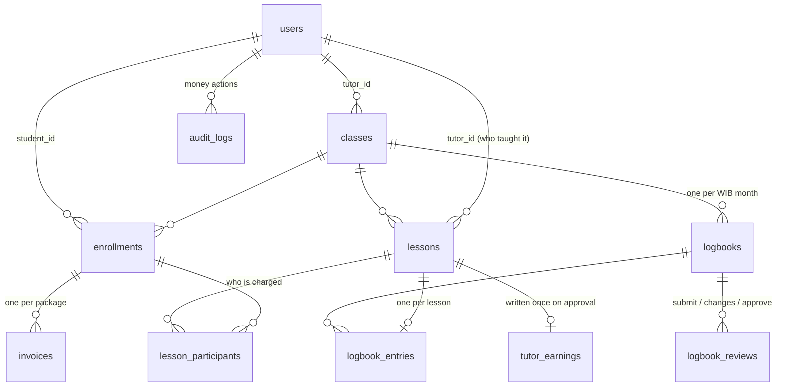

# Architecture

```
 sg-app (Next.js PWA, :3000)          sg-backoffice (Next.js, :3001)
 students + tutors, mobile-first      admins, desktop
          │  /api/* rewrite (same origin, httpOnly cookie)  │
          └──────────────────────┬───────────────────────────┘
                     sg-api (Express + TypeScript, :4000)
                     zod validation · role-scoped routers · services
                                 │  node-postgres, hand-written SQL
                          PostgreSQL (constraints, triggers, views)
```

The API is the only thing that talks to the database. Each frontend proxies `/api/*` to it, so the session cookie is first-party and no CORS is involved. Each client gets its own cookie (`sg_app_session` / `sg_bo_session`): the back office only accepts admins, and the app only accepts tutors and students.

## Data model



- **Money** is IDR in `BIGINT`, and **time** is in minutes, so there are no floats. Every price is snapshotted where it's used: the student rate on each invoice, and the tutor rate on each lesson.
- **Hours** are derived, never stored as a running total:
  - *paid* = paid invoices
  - *used* = `lesson_participants` rows for lessons that have ended
  - *reserved* = the same for upcoming lessons
- **Shared views** (`v_enrollment_balance`, `v_invoice_aging`, `v_class_financials`) compute balances, aging and margin once. The student's meter, the tutor's view and the admin dashboard all read them, so their numbers can't disagree.

## Where business rules are enforced, and why

**Invariants live in PostgreSQL**, so no API bug, script or race condition can break them. **Workflow and visibility rules live in the API services**, where they need context such as who is asking or what state something is in. Every rule is also covered by a test in `test/rules.test.ts`.

| Rule | Enforced by |
|---|---|
| No duplicate enrollment | Partial unique index `(class_id, student_id) WHERE status <> 'cancelled'` |
| Never exceed capacity | `SELECT … FOR UPDATE` on the class row inside the enrollment transaction (tested with two concurrent enrollments) |
| End after start; tutor lessons can't overlap | `CHECK (ends_at > starts_at)`; `EXCLUDE USING gist (tutor_id WITH =, tstzrange(...) WITH &&)` on scheduled lessons |
| One logbook per class per month | `UNIQUE (class_id, month)` |
| One entry per lesson that has ended | `UNIQUE (lesson_id)` plus a trigger checking the lesson has ended, isn't cancelled, and is in the same class and month |
| Approved logbook is read-only | Triggers block updates and deletes on an approved logbook and its entries |
| Earnings once per lesson; re-approval adds nothing | `UNIQUE (lesson_id)` on `tutor_earnings` plus `ON CONFLICT DO NOTHING`; an approve call on an approved logbook is a no-op |
| Only admins approve; tutors see only their classes; students only paid classes | Router-level `requireRole`, plus every query scoped by `req.user` (another user's data returns 404) |
| Logbooks hidden from students until approved | Student queries filter `status = 'approved'` in SQL, so the API can't return unapproved logbooks |
| Tutors never see student rates | Per-role SQL projections: tutor queries never select rates or amounts (tested on the raw JSON) |
| One unpaid package per enrollment; paid/void fields consistent | Partial unique index plus `CHECK` constraints on `invoices` |

Times are stored as UTC `timestamptz`. The API only accepts ISO timestamps with an explicit offset; the UI always sends WIB (`+07:00`) and displays in `Asia/Jakarta`. Logbook months are computed in WIB (`wib_month()`).

## API contract

`openapi.yaml` (OpenAPI 3.1) documents all 42 endpoints and is served at `/docs`. The frontends generate their TypeScript types from it with `openapi-typescript`, and call the API through `openapi-fetch`, so a renamed field breaks their typecheck. A contract test fails if a route is undocumented or a response drifts from the spec. All JSON is camelCase; SQL rows are converted once at the response boundary.

## Design system

The tokens from the brief are defined once, as CSS variables in `src/app/globals.css` of each frontend:
- navy `#2F3F5F`, gold `#F1C019`, surface `#FAFDFF`, cloud `#E0E2E7` / `#6E7585`, status `#0AB848` / `#FF2819`
- DM Sans
- 6px card radius, as a `--radius-card` token

**Accessibility exception.** As *text* on the light surface, the brief's status colours fail WCAG AA: `#0AB848` is 2.6:1 and `#FF2819` is 3.7:1, against a required 4.5:1. The same goes for the muted grey on grey backgrounds. So the text tokens use the nearest shades that pass 4.5:1:
- success `#05732F`
- destructive `#C8170A`
- warning `#8A6400`
- muted `#646B7B`

The exact brand hexes stay defined as `--sg-*` tokens. An automated axe scan of every screen checks this (see the e2e suite).

They're mapped onto shadcn/ui's semantic variables (`--primary`, `--accent`, `--destructive`, plus custom `--success`/`--warning`), so every component (Radix-based, in `components/ui/`) picks up the brand without per-component styling.

On top of that sit three layers:
- `components/ui-kit.tsx`: `StatusBadge` (one status → colour/label map for invoices, logbooks, lessons and balance flags), `StatCard`, `HoursMeter`, and loading/empty/error states
- `lib/format.ts`: IDR, durations, and WIB dates
- per-app shells: a sidebar for the back office, and a bottom nav with safe-area insets for the PWA

Because the repos are separate, `ui-kit.tsx`, `format.ts` and `components/ui` are copied between the two frontends. A shared package is the next step (see DECISIONS.md).

**PWA:**
- `app/manifest.ts`, with icons generated by `ImageResponse`
- a small service worker (`public/sw.js`): cache-first for hashed assets, network-first for pages, an offline fallback, and **never caches `/api`**, so hours and invoices are always live and personal data doesn't linger after logout
