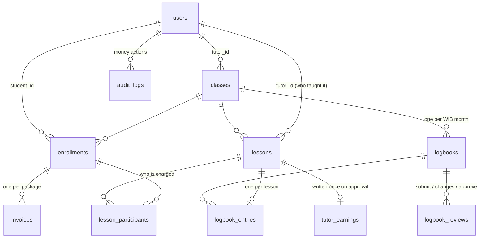

# Architecture

```
 sg-app (Next.js PWA, :3000)            sg-backoffice (Next.js, :3001)
 students + tutors, mobile-first        admins, desktop
          │   /api/* rewrite → same-origin httpOnly cookie   │
          └───────────────────────┬──────────────────────────┘
                     sg-api (Express + TypeScript, :4000)
                     zod validation · role-scoped routers · services
                                  │  node-postgres, hand-written SQL
                       PostgreSQL (constraints, triggers, views)
```

Only the API talks to the database. Each frontend proxies `/api/*` to it, so the session cookie is first-party (one per client: the back office accepts only admins, the app only tutors and students). `openapi.yaml` (served at `/docs`) is the contract: the frontends generate their types from it, and a contract test fails if a route or response drifts.

## Data model



- **Money** is IDR in `BIGINT` and **time** is in minutes: no floats. Prices are snapshotted where they're used (student rate on each invoice, tutor rate on each lesson).
- **Hours are derived, never stored as a counter.** *Paid* = paid invoices; *used* = lessons that ended **and** were logged by the tutor; *awaiting* = ended but not logged (held, not deducted); *reserved* = upcoming lessons.
- **One set of SQL views** (`v_enrollment_balance`, `v_invoice_aging`, `v_class_financials`) computes balances, aging and margin, so the student, tutor and admin screens can't disagree.
- Times are UTC `timestamptz`; the API only accepts timestamps with an offset, the UI sends and shows WIB, and logbook months are WIB months.

## Where business rules are enforced, and why

**Invariants live in PostgreSQL**, so no API bug, script or race can break them. **Workflow and visibility rules live in the API services**, where they need to know who is asking. Every rule has a test (`test/rules.test.ts`, plus the e2e suite).

| Rule | Enforced by |
|---|---|
| No duplicate enrollment · one unpaid package per enrollment | Partial unique indexes |
| Never exceed capacity | Row lock on the class (`SELECT … FOR UPDATE`) in the enrollment transaction; tested with concurrent enrollments |
| End after start · a tutor's lessons can't overlap | `CHECK`; `EXCLUDE USING gist (tutor_id WITH =, tstzrange(…) WITH &&)` |
| One logbook per class per month · one entry per ended lesson | `UNIQUE` constraints plus a trigger (lesson ended, not cancelled, same class and month) |
| Approved logbook is read-only | Triggers block changes to an approved logbook and its entries |
| Earnings once per lesson; re-approval adds nothing | `UNIQUE (lesson_id)` on `tutor_earnings` + `ON CONFLICT DO NOTHING`; approving twice is a no-op |
| Roles and ownership (only admins approve, tutors see their classes, students their paid classes) | `requireRole` on routers; every query scoped to `req.user` (others' data → 404) |
| Logbooks hidden from students until approved · tutors never see student rates | Enforced in the student/tutor SQL itself, so the API can't leak them; tested on raw responses |

## Design system

The brief's tokens are CSS variables in each frontend's `src/app/globals.css`: navy `#2F3F5F`, gold `#F1C019`, surface `#FAFDFF`, cloud `#E0E2E7`/`#6E7585`, status `#0AB848`/`#FF2819`, DM Sans, and a 6px card radius (`--radius-card`). They're mapped onto shadcn/ui's semantic variables, so every Radix-based component in `components/ui/` is on-brand without per-component styling.

- **Accessibility:** as text on the light surface, `#0AB848` (2.6:1) and `#FF2819` (3.7:1) fail WCAG AA, so text uses the nearest passing shades (`#05732F`, `#C8170A`, `#8A6400` for gold, `#646B7B` muted). The exact brand values stay as `--sg-*` tokens; an axe scan of every screen guards this.
- **Shared pieces:** `components/ui-kit.tsx` (status badges, stat cards, hours meter, empty/error states) and `lib/format.ts` (IDR, durations, WIB dates). They're copied between the two frontends because the repos are separate; a shared package is a next step.
- **Shells:** a sidebar for the back office; the PWA has a floating bottom nav and bottom-sheet dialogs. Its service worker caches the app shell but **never `/api`**, so balances are always live.
